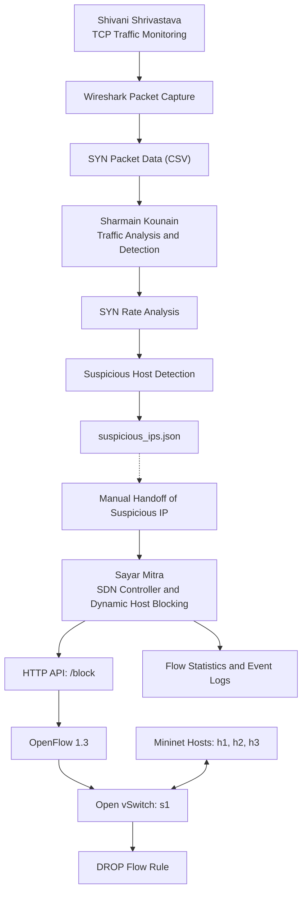

# Dynamic Host Blocking System

## Project Overview

The **Dynamic Host Blocking System** is an SDN-based network security project that monitors TCP traffic, identifies suspicious hosts based on configurable thresholds, and dynamically blocks detected hosts using OpenFlow rules.

The project combines traffic monitoring, suspicious host detection, and Software Defined Networking (SDN) to demonstrate automated network-level response.

## Project Architecture

The following diagram illustrates how the three team members' components work together.



## Architecture Explanation

1. **TCP Traffic Monitoring – Shivani Shrivastava**
   - Generates and monitors TCP traffic.
   - Captures packets using Wireshark.
   - Analyses TCP SYN packet rates.
   - Provides packet data for further analysis.

2. **Traffic Analysis and Detection – Sharmain Kounain**
   - Reads traffic from CSV datasets.
   - Counts TCP SYN packets within fixed time windows.
   - Identifies hosts exceeding the configured SYN threshold.
   - Generates suspicious IP candidates and detection logs.

3. **SDN Controller and Dynamic Host Blocking – Sayar Mitra**
   - Implements an OS-Ken SDN controller.
   - Communicates with Open vSwitch using OpenFlow 1.3.
   - Provides HTTP API endpoints to block and unblock IP addresses.
   - Installs and removes OpenFlow DROP rules.
   - Maintains a blocklist, collects flow statistics, and logs controller events.

## Project Workflow

1. TCP traffic is generated and monitored.
2. Traffic data is analysed to identify suspicious hosts.
3. Suspicious IP addresses are provided to the SDN controller.
4. The controller installs OpenFlow DROP rules to block selected hosts.
5. Hosts can be unblocked through the controller API.
6. Flow statistics and controller events can be inspected.

## Technologies Used

- Python
- Mininet
- Open vSwitch
- OS-Ken
- OpenFlow 1.3
- Wireshark
- Docker
- pandas

## Repository Structure

```text
Dynamic-Host-Blocking-System/
│
├── Person-1-Traffic-Monitoring/
│
├── Person-2-Traffic-Detection/
│
├── Person-3-SDN-Controller/
│
├── .gitignore
│
└── README.md
```

Each folder contains the implementation and supporting files for its respective project component.

## Team Contributions

| Team Member | Responsibility |
|---|---|
| Shivani Shrivastava | TCP Traffic Monitoring |
| Sharmain Kounain | Traffic Analysis and Detection |
| Sayar Mitra | SDN Controller and Dynamic Host Blocking |

## Important Note

The handoff of suspicious IP addresses from Person 2's detection module to Person 3's SDN controller is currently represented as a manual step. Full automatic integration between these components has not yet been demonstrated.

The repository contains the source code, datasets, logs, and supporting documentation for all three components.
