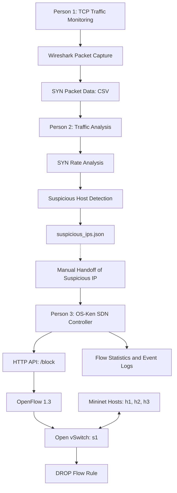

# Dynamic Host Blocking System

## Project Overview

The Dynamic Host Blocking System is an SDN-based network security project that monitors TCP traffic, identifies suspicious hosts based on configurable thresholds, and dynamically blocks detected hosts using OpenFlow rules.

The project combines traffic monitoring, suspicious host detection, and Software Defined Networking (SDN) to demonstrate automated network-level response.

## Project Architecture

The system consists of three major components:

### Person 1 – TCP Traffic Monitoring
- Generates and monitors TCP traffic.
- Captures packets using Wireshark.
- Analyses TCP SYN packet rates.
- Provides packet data for further analysis.

Folder: `Person-1-Traffic-Monitoring/`

### Person 2 – Traffic Analysis and Detection
- Reads traffic from CSV datasets.
- Counts TCP SYN packets within fixed time windows.
- Identifies hosts exceeding the configured SYN threshold.
- Generates suspicious IP candidates and detection logs.

Folder: `Person-2-Traffic-Detection/`

### Person 3 – SDN Controller and Dynamic Host Blocking
- Implements an OS-Ken SDN controller.
- Communicates with Open vSwitch using OpenFlow 1.3.
- Provides HTTP API endpoints to block and unblock IP addresses.
- Installs and removes OpenFlow DROP rules.
- Maintains a blocklist, collects flow statistics, and logs controller events.

Folder: `Person-3-SDN-Controller/`

## Technologies Used

- Python
- Mininet
- Open vSwitch
- OS-Ken
- OpenFlow 1.3
- Wireshark
- Docker
- pandas

## Repository Structure

```text
Dynamic-Host-Blocking-System/
├── Person-1-Traffic-Monitoring/
├── Person-2-Traffic-Detection/
└── Person-3-SDN-Controller/
```

Each folder contains the implementation and supporting files for its respective project component.

## Project Workflow

1. TCP traffic is generated and monitored.
2. Traffic data is analysed to identify suspicious hosts.
3. Suspicious IP addresses are provided to the SDN controller.
4. The controller installs OpenFlow DROP rules to block selected hosts.
5. Hosts can be unblocked through the controller API.
6. Flow statistics and controller events can be inspected.

## Team Contributions

| Member | Responsibility |
|---|---|
| Person 1 | TCP Traffic Monitoring |
| Person 2 | Traffic Analysis and Detection |
| Person 3 | SDN Controller and Dynamic Host Blocking |

## Note

The individual components are maintained in separate folders. The repository contains their source code, datasets, logs, and supporting documentation.


## System Architecture

The following diagram illustrates how the three components of the Dynamic Host Blocking System work together.



### Architecture Explanation

1. **Traffic Monitoring:** Person 1 captures and monitors TCP traffic.
2. **Traffic Detection:** Person 2 analyses traffic and identifies suspicious hosts.
3. **IP Handoff:** Suspicious IP candidates are provided to the SDN controller.
4. **Dynamic Blocking:** Person 3's controller receives a blocking request and installs an OpenFlow DROP rule.
5. **Monitoring:** The controller supports unblocking, flow statistics and event logging.

*Note: The handoff between Person 2 and Person 3 is currently represented as manual. Automatic integration has not yet been demonstrated.*
