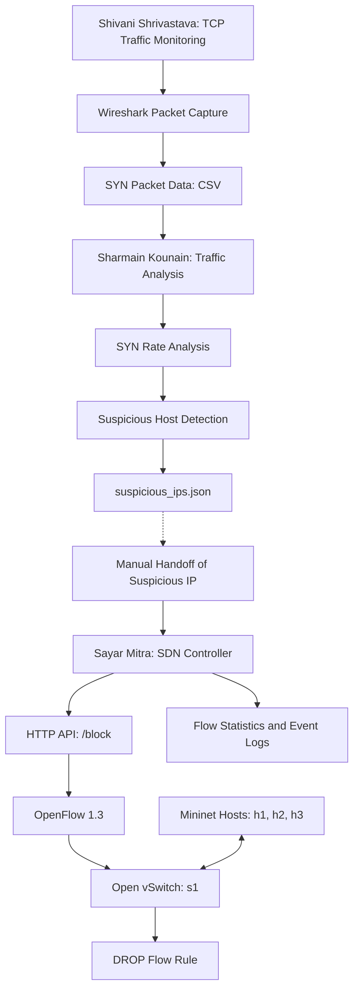

# Dynamic Host Blocking System

An SDN-Based Network Traffic Monitoring, Suspicious Host Detection and Dynamic Blocking System

---

## 1. Project Overview

The **Dynamic Host Blocking System** is a network security project that demonstrates how Software-Defined Networking (SDN) can be used to monitor network traffic, identify potentially suspicious hosts, and dynamically block selected IP addresses.

The system combines TCP traffic monitoring, traffic analysis, suspicious host detection, and SDN-based network control to demonstrate a network-level security response.

The project is divided into three major components, each developed by a team member:

1. TCP Traffic Monitoring
2. Traffic Analysis and Suspicious Host Detection
3. SDN Controller and Dynamic Host Blocking

The detected suspicious IP addresses are passed to the SDN controller, which can install OpenFlow DROP rules on an Open vSwitch instance to prevent the selected host from communicating through the network.

## 2. Project Objectives

- Generate and monitor TCP network traffic.
- Capture packets and extract relevant TCP information.
- Analyse TCP SYN packet activity within configurable time windows.
- Identify hosts exceeding a predefined traffic threshold.
- Maintain a list of suspicious IP addresses.
- Use an SDN controller to dynamically block and unblock selected hosts.
- Install and remove OpenFlow rules on Open vSwitch.
- Collect flow statistics and maintain event logs.
- Demonstrate the effectiveness of network-level traffic blocking.

## 3. System Architecture

The following diagram illustrates the overall architecture and the responsibilities of all three team members.



### Architecture Explanation

**Stage 1 – TCP Traffic Monitoring**

Shivani Shrivastava monitors TCP traffic and captures network packets using Wireshark. Relevant packet information is extracted and stored for further analysis.

**Stage 2 – Traffic Analysis and Detection**

Sharmain Kounain analyses the collected traffic data, counts TCP SYN packets within fixed observation windows, and identifies hosts whose SYN packet counts exceed the configured threshold.

**Stage 3 – Suspicious IP Identification**

The detection module generates a JSON file containing suspicious IP candidates and their associated detection information.

**Stage 4 – SDN Controller**

Sayar Mitra implements the SDN controller using OS-Ken. The controller exposes an HTTP API through which IP addresses can be blocked or unblocked.

**Stage 5 – Dynamic Host Blocking**

The controller communicates with Open vSwitch using OpenFlow 1.3. It installs a DROP flow rule for the selected source IP address, preventing matching IPv4 traffic from being forwarded.

**Stage 6 – Monitoring and Logging**

The controller provides flow statistics, blocklist information, and event logs to help monitor the network and verify blocking operations.

*Note: The handoff from Person 2's detection output to Person 3's controller is currently a manual step. Fully automated integration between the two components has not yet been demonstrated.*

## 4. Project Workflow

The system follows the workflow below:

1. TCP traffic is generated and monitored.
2. Wireshark captures relevant network packets.
3. Packet information is extracted into a CSV dataset.
4. The traffic analysis module reads the dataset.
5. TCP SYN packets are counted within fixed time windows.
6. Hosts exceeding the configured threshold are marked as suspicious candidates.
7. Suspicious IP addresses are saved in a JSON file.
8. A selected suspicious IP address is provided to the SDN controller.
9. The controller receives a blocking request through its HTTP API.
10. An OpenFlow DROP rule is installed on Open vSwitch.
11. The selected host's matching traffic is blocked.
12. The host can subsequently be unblocked through the controller API.

## 5. Individual Contributions

### Person 1 – Shivani Shrivastava
**TCP Traffic Monitoring**

Responsibilities:

- TCP traffic generation and monitoring.
- Packet capture using Wireshark.
- Extraction of TCP SYN packet information.
- Recording packet information in CSV format.
- Monitoring TCP SYN packet rates.
- Providing traffic data for the detection module.

Main project files:

- `tcp_rate_monitor.py`
- `tcp_rate_results.txt`
- `syn_packets.csv`
- `tcp_capture.pcapng`

### Person 2 – Sharmain Kounain
**Traffic Analysis and Suspicious Host Detection**

Responsibilities:

- Reading and processing traffic datasets.
- Identifying TCP SYN packets.
- Counting SYN packets within fixed observation windows.
- Applying configurable detection thresholds.
- Identifying suspicious host IP addresses.
- Generating detection logs and JSON output.

Detection configuration:

| Parameter | Value |
|---|---|
| SYN threshold | 3 packets |
| Observation window | 10 seconds |
| Detection condition | SYN count greater than 3 |
| Output format | JSON |

Main project files:

- `config.py`
- `src/main.py`
- `src/traffic_analyzer.py`
- `src/detector.py`
- `src/blocklist.py`
- `src/logger.py`
- `data/traffic.csv`
- `output/suspicious_ips.json`
- `output/detection.log`

### Person 3 – Sayar Mitra
**SDN Controller and Dynamic Host Blocking**

Responsibilities:

- Setting up the Mininet network topology.
- Configuring Open vSwitch.
- Implementing the OS-Ken SDN controller.
- Establishing communication using OpenFlow 1.3.
- Developing HTTP API endpoints for blocking and unblocking hosts.
- Installing and removing OpenFlow DROP rules.
- Maintaining an in-memory blocklist.
- Collecting flow statistics.
- Recording controller events.

Main project files:

- `controller.py`
- `controller_backup.py`
- `controller_v2.py`
- `events.log`

## 6. Technologies and Tools Used

| Technology | Purpose |
|---|---|
| Python | Implementation of monitoring, detection and controller logic |
| Wireshark | Network packet capture and inspection |
| pandas | Processing and analysing traffic datasets |
| Mininet | Network emulation and virtual host creation |
| Open vSwitch | Software-based network switching |
| OS-Ken | SDN controller framework |
| OpenFlow 1.3 | Communication between controller and switch |
| Docker | Containerised controller environment |
| Ubuntu | Development and execution environment |
| GitHub | Source code management and collaboration |

## 7. SDN Controller Implementation

The SDN controller is implemented using OS-Ken and supports OpenFlow 1.3.

The controller provides two main functions:

**1. Network forwarding**

- Learns host MAC addresses and their associated switch ports.
- Maintains a MAC-to-port mapping.
- Forwards packets through the appropriate switch ports.
- Uses lower-priority forwarding rules.

**2. Dynamic host blocking**

- Receives IP addresses through HTTP POST requests.
- Validates the supplied IP address.
- Installs a high-priority OpenFlow DROP rule.
- Maintains a list of blocked IP addresses.
- Supports removal of blocking rules.

### Controller API

The HTTP API listens on port `8080`.

| Method | Endpoint | Purpose |
|---|---|---|
| POST | `/block` | Block a specified IP address |
| POST | `/unblock` | Remove the blocking rule |
| GET | `/blocklist` | Retrieve currently blocked IP addresses |
| GET | `/stats` | Request and retrieve switch flow statistics |

### Example API Requests

**Block an IP address**

```json
{
  "ip": "10.0.0.2"
}
```

Send this JSON body using a POST request to:

```text
http://<controller-ip>:8080/block
```

**Unblock an IP address**

```json
{
  "ip": "10.0.0.2"
}
```

Send this JSON body using a POST request to:

```text
http://<controller-ip>:8080/unblock
```

**Retrieve the blocklist**

```text
GET http://<controller-ip>:8080/blocklist
```

**Retrieve flow statistics**

```text
GET http://<controller-ip>:8080/stats
```

## 8. Mininet Network Topology

The SDN network is emulated using Mininet.

The demonstration topology consists of:

- Three virtual hosts: `h1`, `h2`, and `h3`.
- One Open vSwitch instance: `s1`.
- One remote SDN controller.
- OpenFlow 1.3 communication.

### Host Addressing

| Host | IP Address |
|---|---|
| h1 | 10.0.0.1 |
| h2 | 10.0.0.2 |
| h3 | 10.0.0.3 |

### Network Topology

```text
             SDN Controller
                 OS-Ken
                   |
             OpenFlow 1.3
                   |
             Open vSwitch
                  s1
             /     |     \
            /      |      \
           h1      h2      h3
        10.0.0.1  10.0.0.2  10.0.0.3
```

## 9. Testing and Verification

The SDN controller was tested using Mininet and Open vSwitch.

The following operations were verified:

| Test | Expected Result |
|---|---|
| Initial connectivity test | Hosts communicate successfully |
| Block h2 | Traffic from h2 is dropped |
| Ping h1 to h2 after blocking | Packet loss |
| Ping h1 to h3 after blocking h2 | Communication remains successful |
| Unblock h2 | Blocking rule is removed |
| Ping h1 to h2 after unblocking | Communication is restored |
| Retrieve blocklist | Returns currently blocked IP addresses |
| Retrieve flow statistics | Returns switch flow information |
| Event logging | Controller events are recorded |

### Example Blocking Behaviour

Before blocking:

- h1 can communicate with h2.
- h1 can communicate with h3.

After blocking `10.0.0.2`:

- Traffic matching the blocking rule is dropped.
- h1 cannot successfully ping h2.
- h1 can still communicate with h3.

After unblocking `10.0.0.2`:

- The blocking rule is removed.
- Communication between h1 and h2 is restored.

## 10. Repository Structure

```text
Dynamic-Host-Blocking-System/
│
├── Person-1-Traffic-Monitoring/
│   ├── README.md
│   ├── syn_packets.csv
│   ├── tcp_capture.pcapng
│   ├── tcp_rate_monitor.py
│   └── tcp_rate_results.txt
│
├── Person-2-Traffic-Detection/
│   ├── README.md
│   ├── requirements.txt
│   ├── config.py
│   │
│   ├── data/
│   │   └── traffic.csv
│   │
│   ├── output/
│   │   ├── detection.log
│   │   └── suspicious_ips.json
│   │
│   └── src/
│       ├── __init__.py
│       ├── blocklist.py
│       ├── detector.py
│       ├── detector.py.py
│       ├── logger.py
│       ├── main.py
│       └── traffic_analyzer.py
│
├── Person-3-SDN-Controller/
│   ├── README.md
│   ├── controller.py
│   ├── controller_backup.py
│   ├── controller_v2.py
│   └── events.log
│
├── .gitignore
└── README.md
```

## 11. Limitations

- The current suspicious IP handoff between the detection module and SDN controller is manual.
- The controller's blocklist is maintained in memory and is not persistent across controller restarts.
- Blocking rules are installed on switches connected at the time of the request; reconnecting switches do not automatically receive previously applied blocks.
- The sample traffic datasets and detection thresholds are intended for demonstration and evaluation, not as a complete production intrusion detection system.
- The HTTP API does not currently implement authentication and should only be exposed in a controlled testing environment.

## 12. Future Enhancements

- Automate the integration between the detection module and SDN controller.
- Automatically pass suspicious IP addresses to the controller.
- Persist the blocklist across controller restarts.
- Reinstall existing blocking rules when switches reconnect.
- Introduce authentication and access control for the HTTP API.
- Implement more advanced traffic analysis and anomaly detection.
- Develop a real-time dashboard for traffic monitoring, suspicious hosts, blocked IPs and flow statistics.
- Extend the system to support additional network topologies and hosts.

## 13. Team Members

| Name | Project Responsibility |
|---|---|
| Shivani Shrivastava | TCP Traffic Monitoring |
| Sharmain Kounain | Traffic Analysis and Suspicious Host Detection |
| Sayar Mitra | SDN Controller and Dynamic Host Blocking |

---

**Project:** Dynamic Host Blocking System  
**Domain:** Computer Networks and Software-Defined Networking  
**Controller Framework:** OS-Ken  
**Protocol:** OpenFlow 1.3
